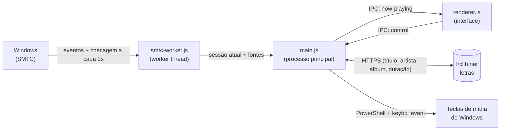

<div align="center">

# 🎧 Spotify Now Playing Widget

**Uma aba flutuante para Windows que mostra, em tempo real, a música que está tocando — com capa, blur, letra sincronizada e modo tela cheia.**


</div>

---

## 📑 Índice

- [O que é](#-o-que-é)
- [Capturas de tela](#-capturas-de-tela)
- [Funcionalidades](#-funcionalidades)
- [Instalação](#-instalação)
- [Como usar](#-como-usar)
- [Modo tela cheia e vibes](#-modo-tela-cheia-e-vibes)
- [Como funciona por baixo dos panos](#-como-funciona-por-baixo-dos-panos)
- [Estrutura do projeto](#-estrutura-do-projeto)
- [Personalização](#-personalização)
- [Solução de problemas](#-solução-de-problemas)
- [Privacidade](#-privacidade)
- [Créditos e avisos](#-créditos-e-avisos)

---

## 💡 O que é

O **Spotify Now Playing Widget** é um mini player que fica **sempre por cima das outras janelas** do Windows, mostrando o que você está ouvindo: capa do álbum, nome da música, artista, barra de progresso ao vivo, botões de controle e letra sincronizada.

O grande diferencial: **não precisa de login, Client ID, token nem conta Premium.**
Ele não usa a API do Spotify. Em vez disso, lê a música direto do **Windows** — a mesma informação que aparece no mixer de volume quando você aperta as teclas de mídia do teclado. Por isso funciona com **Spotify, Windows Media Player, navegador, VLC** e qualquer outro player que o Windows reconheça.

---

## 📸 Capturas de tela

<table>
  <tr>
    <td align="center" width="33%">
      <br>
      <sub><b>Letra sincronizada</b><br>A linha atual fica em destaque e a letra rola sozinha. As cores vêm da capa (aqui, roxo).</sub>
    </td>
    <td align="center" width="33%">
      <br>
      <sub><b>Cor que acompanha a capa</b><br>Cada música muda o brilho, o blur e a borda do card. Letras em outros alfabetos (cirílico etc.) funcionam normalmente.</sub>
    </td>
    <td align="center" width="33%">
      <br>
      <sub><b>Letra sem sincronização</b><br>Quando só existe a versão em texto simples, ela aparece como texto corrido no painel.</sub>
    </td>
  </tr>
</table>

---

## ✨ Funcionalidades

| Recurso | Descrição |
| --- | --- |
| 📌 **Janela flutuante** | Sem moldura, transparente, sempre por cima e fora da barra de tarefas. Aparece no canto superior direito da tela. |
| 🖼️ **Capa + fundo desfocado** | A capa do álbum vira um fundo com blur que muda suavemente (crossfade) a cada música. |
| 🎨 **Cor de destaque automática** | A cor média da capa é extraída e usada na borda animada do card e nos detalhes. |
| 💿 **Capa giratória e equalizador** | A capa gira devagar e as barrinhas do equalizador dançam enquanto a música toca. |
| ⏱️ **Progresso ao vivo** | Barra de progresso com tempo atual e total, atualizada em tempo real. |
| ⏯️ **Controles** | Tocar/pausar, anterior e próxima — funcionam com qualquer player e qualquer conta (Free ou Premium). |
| 📝 **Letra sincronizada** | Painel que expande o card, rola sozinho e destaca a linha atual. Se não houver versão sincronizada, mostra o texto simples. |
| 🖥️ **Tela cheia com vibes** | Fundo animado com partículas e cores de acordo com o clima escolhido (Apaixonado, Raiva, Funk, Triste, Feliz, Calmo). |
| 🖱️ **Arrastar com efeito elástico** | Clique e arraste em qualquer parte: o card "flutua" atrás do cursor. A posição é lembrada. |
| 🔀 **Troca de fonte** | Com mais de um player tocando, clique no selo do player (ex.: "Spotify") para alternar entre eles. |
| 🌄 **Foto de fundo personalizada** | Escolha uma imagem do seu PC para ficar fixa no lugar da capa desfocada. |
| 🔔 **Ícone na bandeja** | Mostrar/esconder, trocar foto de fundo, restaurar o padrão e sair. |
| 🔒 **100% local** | Nenhum dado seu é enviado a ninguém (veja [Privacidade](#-privacidade)). |

---

## 🚀 Instalação

### Requisitos

- **Windows 10 ou 11** (o widget usa o controle de mídia do Windows)
- **Node.js (versão LTS)** — baixe em <https://nodejs.org>

### Opção 1 — Jeito fácil (recomendado)

1. Instale o **Node.js LTS**.
2. Baixe/clone este repositório e extraia numa pasta qualquer.
3. Dê **2 cliques em `iniciar.bat`**.

Na primeira vez ele instala tudo sozinho (pode demorar um pouco) e já cria o atalho **"Spotify Widget"** na sua Área de Trabalho, com o ícone certinho.
Nas próximas vezes, é só abrir esse atalho — sem terminal e sem janela preta.

### Opção 2 — Pelo terminal

```bash
git clone https://github.com/pedroyan2310-ctrl/spotify-Now-Playing.git
cd spotify-Now-Playing
npm install
npm start
```

### Abrir junto com o Windows (opcional)

1. Aperte `Win + R`, digite `shell:startup` e dê Enter.
2. Copie o atalho **"Spotify Widget"** da Área de Trabalho para essa pasta.

---

## 🕹️ Como usar

| Ação | Como fazer |
| --- | --- |
| **Arrastar** | Clique e arraste em qualquer parte do card (fora dos botões). |
| **Tocar / pausar / pular** | Os três botões enviam as mesmas teclas de mídia do teclado. |
| **Ver a letra** | Clique no ícone de linhas (topo do card). O card expande e a letra rola sozinha. |
| **Tela cheia** | Clique no ícone de cantos (topo do card). Escolha uma vibe. Saia com o botão de voltar ou com **ESC**. |
| **Trocar de player** | Clique no selo com o nome do player (ex.: "Spotify") quando houver mais de uma fonte tocando. A escolha fica salva. |
| **Esconder** | Passe o mouse no canto do card e clique no **×**. |
| **Mostrar de novo** | Clique no ícone do widget na bandeja do sistema (perto do relógio — pode estar nas setinhas escondidas). |
| **Foto de fundo** | Bandeja → botão direito → **Escolher foto de fundo...** |
| **Voltar ao fundo da capa** | Bandeja → botão direito → **Remover foto personalizada**. |
| **Restaurar tudo** | Bandeja → botão direito → **Restaurar tudo (padrão)** — volta posição, cor, fonte e fundo. |
| **Sair de vez** | Bandeja → botão direito → **Sair**. |

> **Dica:** quando nada está tocando, o widget mostra "Nada tocando agora".

---

## 🌈 Modo tela cheia e vibes

Ao entrar na tela cheia você escolhe uma **vibe**. Cada uma muda o degradê de fundo, as cores, o formato e o movimento das partículas. Dá para trocar a vibe a qualquer momento clicando na tag no topo.

| Vibe | Visual |
| --- | --- |
| 💕 **Apaixonado** | Círculos rosa que sobem devagar, com brilho suave |
| 🔥 **Raiva** | Triângulos vermelhos e laranja, rápidos e tremidos |
| 🎉 **Funk** | Quadrados neon (rosa, ciano, amarelo e verde) quicando no ritmo |
| 🌧️ **Triste** | Pontinhos azuis caindo como chuva |
| ✨ **Feliz** | Quadrados dourados e laranja saltitantes |
| 🌙 **Calmo** | Círculos grandes e translúcidos, em tons de verde-água, flutuando lentamente |

Na tela cheia também aparecem a capa, o nome da música, os controles grandes e a letra com a linha anterior, a atual e a próxima.

---

## 🧠 Como funciona por baixo dos panos



### 1. Leitura da música (SMTC)

O Windows mantém um *System Media Transport Controls* (SMTC) com as sessões de mídia ativas. O projeto usa a biblioteca [`@coooookies/windows-smtc-monitor`](https://www.npmjs.com/package/@coooookies/windows-smtc-monitor) dentro de uma **worker thread** (`smtc-worker.js`), para consultar o Windows sem travar a janela.

- Escuta os eventos de mudança de mídia, linha do tempo, reprodução e entrada/saída de sessões.
- Como "rede de segurança", reenvia o estado a cada **2 segundos**, para a barra de progresso nunca travar.
- **Qual sessão mostrar** (por ordem de prioridade): fonte escolhida manualmente → **Spotify** (se estiver tocando) → sessão "atual" do Windows → qualquer sessão com mídia.

### 2. Controles

Os botões não falam com a API do Spotify. Eles simulam as **teclas de mídia do Windows** (`VK_MEDIA_PLAY_PAUSE`, `VK_MEDIA_NEXT_TRACK`, `VK_MEDIA_PREV_TRACK`) via PowerShell (`keybd_event`, em janela oculta). Por isso funcionam com qualquer player.

> O Windows só expõe play/pausa/anterior/próxima — **não existe botão de shuffle ou repetir** porque essas informações não saem do player.

### 3. Letras (lrclib.net)

As letras vêm do [lrclib.net](https://lrclib.net), gratuito e sem chave. A busca tenta, em ordem, até achar:

1. Busca **exata** (título + artista + álbum + duração)
2. Busca livre com os nomes originais
3. Busca com nomes **"limpos"** (sem `feat.`, `Remastered`, `Official Video`, `[...]` etc.)
4. Busca só com o **primeiro artista** (quando vem "A, B" ou "A feat. B")
5. Busca livre juntando título + artista num único texto

O resultado é guardado em cache (até 60 músicas). Se existir versão sincronizada (formato LRC), a letra rola e destaca a linha atual; se só existir texto simples, ele é exibido corrido; se não achar nada, mostra um aviso.

### 4. Visual

- **Fundo desfocado:** dois elementos de fundo se alternam com *crossfade* para a troca de capa ser suave.
- **Cor de destaque:** a capa é reduzida a 8×8 pixels, calcula-se a cor média e ela é levemente clareada para virar a variável CSS `--accent`.
- **Borda animada:** um `conic-gradient` girando ao redor do card (`@keyframes spin`).
- **Janela:** modo compacto `430×164` e modo com letra `430×560`, com animação de altura suave.
- **Arrastar elástico:** o processo principal move a janela em direção ao cursor a cada ~16 ms, aproximando 35% da distância por quadro.

### 5. Configurações salvas

O widget guarda um `config.json` na pasta de dados do app (normalmente `%APPDATA%\spotify-now-playing-widget\config.json`) com:

| Chave | O que guarda |
| --- | --- |
| `winPos` | Última posição da janela |
| `preferredSource` | Player escolhido manualmente |
| `customBackground` | Caminho da foto de fundo personalizada |

### 6. Segurança da interface

A janela usa `contextIsolation: true` e `nodeIntegration: false`. O `preload.js` expõe para a interface só um conjunto pequeno de funções via `contextBridge` (controlar, arrastar, abrir letra/tela cheia, trocar fonte e receber eventos).

---

## 🗂️ Estrutura do projeto

```text
.
├── main.js                   # Processo principal: janela, bandeja, IPC, letras, teclas de mídia
├── preload.js                # Ponte segura (contextBridge) entre o main e a interface
├── smtc-worker.js            # Worker thread que consulta o Windows sobre a música atual
├── package.json              # Dependências e script "npm start"
├── iniciar.bat               # Instala dependências, cria o atalho e abre o widget
├── Abrir Spotify Widget.vbs  # Abre o widget sem janela de terminal (usado pelo atalho)
├── assets/
│   ├── icon.ico              # Ícone do atalho
│   ├── icon.png              # Ícone da janela
│   └── tray.png              # Ícone da bandeja do sistema
├── src/
│   ├── index.html            # Estrutura da interface (card, letras, tela cheia)
│   ├── style.css             # Visual: blur, borda animada, equalizador, temas
│   ├── renderer.js           # Lógica da interface: progresso, letras, cor, arrastar
│   └── fullscreen.js         # Tela cheia: vibes e partículas em canvas
└── docs/
    └── screenshots/          # Imagens usadas neste README
```

**Tecnologias:** [Electron](https://www.electronjs.org/) 33 · JavaScript · HTML/CSS · Canvas 2D · Node.js `worker_threads`.

---

## 🛠️ Personalização

| Quero mudar... | Onde |
| --- | --- |
| Tamanho do card (compacto / com letra) | `COMPACT_SIZE` e `EXPANDED_SIZE`, no topo do `main.js` |
| Posição inicial | `createWindow()` no `main.js` (padrão: canto superior direito) |
| Cor padrão (antes de ler a capa) | variável `--accent` no `:root` do `src/style.css` (padrão `#1ED760`) |
| Velocidade da borda animada | `animation: spin 7s ...` em `.card::before`, no `style.css` |
| Cores, formato e movimento das vibes | objeto `VIBES` no `src/fullscreen.js` |
| Adicionar uma vibe nova | crie a entrada em `VIBES` **e** um botão `<button class="vibe-btn" data-vibe="nome">` no seletor de vibes do `index.html` |

---

## 🩺 Solução de problemas

<details>
<summary><b>"Node.js não foi encontrado"</b></summary>

Instale a versão **LTS** em <https://nodejs.org>, feche e abra o terminal (ou rode o `iniciar.bat` de novo).
</details>

<details>
<summary><b>A instalação das dependências falhou</b></summary>

Abra um terminal na pasta do projeto e rode `npm install` para ver a mensagem de erro completa. Confira se você está no **Windows** (a biblioteca de leitura de mídia é específica do sistema) e se está usando o Node **LTS**.
</details>

<details>
<summary><b>Aparece "Nada tocando agora"</b></summary>

O widget mostra o que o **Windows** enxerga. Abra o player, dê play e veja se a música aparece no controle de mídia do Windows (o mesmo das teclas de mídia). Se o Windows não mostra, o widget também não.
</details>

<details>
<summary><b>O widget sumiu</b></summary>

Clique no ícone dele na bandeja do sistema (perto do relógio; pode estar nas setinhas escondidas) ou use o menu → **Mostrar**. Se ele estiver fora da tela, use **Restaurar tudo (padrão)**.
</details>

<details>
<summary><b>A letra não aparece ou veio errada</b></summary>

As letras vêm do lrclib.net por nome da música/artista. Músicas muito novas, remixes, versões *sped up* ou com nome diferente do original podem não ser encontradas.
</details>

<details>
<summary><b>Os botões não respondem</b></summary>

Eles enviam as teclas de mídia do Windows, e o comando vai para o player que o Windows considera ativo. Se outro programa estiver capturando essas teclas, ele pode receber o comando no lugar.
</details>

<details>
<summary><b>Aparece "Deu um erro" no card</b></summary>

A mensagem mostrada embaixo diz o que falhou (por exemplo, o módulo de leitura de mídia não carregou). Rode `npm install` de novo e confirme que está no Windows.
</details>

---

## 🔐 Privacidade

- Não há login, conta, token ou telemetria.
- Tudo roda **localmente** no seu PC.
- A única coisa que sai do computador é a **busca da letra**, feita no [lrclib.net](https://lrclib.net) com o **título, artista, álbum e duração** da música atual.

---

## 🙏 Créditos e avisos

- [Electron](https://www.electronjs.org/) — base do app
- [`@coooookies/windows-smtc-monitor`](https://www.npmjs.com/package/@coooookies/windows-smtc-monitor) — leitura do controle de mídia do Windows
- [lrclib.net](https://lrclib.net) — base pública de letras sincronizadas

Este é um projeto independente e **não tem vínculo com a Spotify AB**. "Spotify" é marca registrada de seus respectivos donos. As letras pertencem aos seus autores; o widget apenas as exibe localmente e não as armazena nem redistribui.

Sugestões, *issues* e *pull requests* são bem-vindos! ⭐ Se curtiu, deixe uma estrela no repositório.
